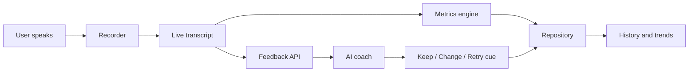

# Architecture Overview

**Purpose:** Show how VoiceLab is built and how data moves.
**Last updated:** 2026-10-12

## In one paragraph

VoiceLab is a Next.js web app, installable on a phone (a PWA). Recording and storage happen in the user's browser. Live transcription uses the browser's built-in speech recognition (see privacy boundaries below). The server only does two things: forward transcript text to the AI coach, and (as a fallback) transcribe audio. Nothing is stored on a server. The transcription approach is provisional until the feasibility spike (milestone 1, checkpoint C5).

## Components

| Component | Where it runs | Job |
|-----------|---------------|-----|
| UI screens | Browser | Home, session, feedback, history, settings |
| Recorder | Browser | Captures audio from the microphone |
| Transcriber | Browser (Web Speech API) | Live transcript while the user speaks |
| Metrics engine | Browser | Computes fillers per minute, words per minute |
| Repository | Browser (IndexedDB) | Saves and loads sessions and settings |
| Feedback API | Server (Next.js route) | Sends transcript text to the AI coach, returns keep/change/retry |
| Transcribe API | Server (Next.js route) | Fallback: audio to text when Web Speech is unavailable |
| Access gate and cost guard | Server | Passphrase check, rate limit, and daily call cap, with counters in a small shared store (server memory alone is not reliable on serverless hosting; see risks.md R4) |

## Data flow for one session



## Privacy boundaries

- Saved recordings stay on the device.
- Live transcription uses the browser's speech recognition. In most browsers this sends audio to the browser maker's servers, not ours. The user must be told. The spike confirms what happens on the user's phone (C5).
- If the Whisper fallback is used, audio goes to OpenAI through our server route. The user is told.
- Only transcript text is sent to the AI coach.
- No accounts and no server database in v1.

## Planned code layout

```
src/
  app/            Screens and API routes
  config/         Model names and limits (one place to change them)
  server/         Server-only code: settings check, passphrase gate, rate limits, the coach
  core/           Pure logic: metrics, feedback parsing, focus rules (most tests live here)
  data/           Repository over IndexedDB
  audio/          Recorder and transcriber wrappers
  components/     Reusable UI pieces
  theme/          All colors and fonts, and the CSS built from them
tests/            Unit, integration, and a few end-to-end tests
documents/        This folder
```

Rule: logic goes in `core/` with no browser dependencies, so it can be tested quickly.

## Feedback route

`POST /api/feedback` with header `x-voicelab-passphrase` and body `{ transcript, durationSec, focusId, previousChange }`. Checks run in this order, so nothing costs money until the last step: settings present (500 naming the missing variable), passphrase (401), body shape and size (400), shared rate limit (429 with `Retry-After`; 503 if the counter store is down), then the coach (200 `{ feedback }`, 422 if declined, 502 on failure). Logic: `src/server/feedbackHandler.ts`; prompt: `src/core/coachPrompt.ts`.

## Failure behavior

| Failure | What the user sees |
|---------|--------------------|
| Microphone blocked | Plain explanation and how to enable it |
| Web Speech unavailable | Automatic switch to the Whisper fallback |
| Offline | Session is saved; feedback is requested when back online |
| AI call fails or cap reached | Transcript and numbers still shown; coach feedback retried later |
