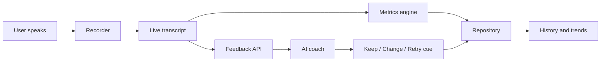

# Architecture Overview

**Purpose:** Show how VoiceLab is built and how data moves.
**Last updated:** 2026-10-12

## In one paragraph

VoiceLab is a Next.js web app, installable on a phone (a PWA). Recording and storage happen in the user's browser. Live transcription uses the browser's built-in speech recognition (see privacy boundaries below). The server only does two things: forward transcript text to the AI coach, and (as a fallback) transcribe audio. Nothing is stored on a server. The transcription approach is provisional until the feasibility spike (milestone 1, checkpoint C5).

## Components

| Component | Where it runs | Job |
|-----------|---------------|-----|
| UI screens | Browser | Home, session, feedback, history, settings |
| Recorder | Browser | Captures audio from the microphone |
| Transcriber | Browser (Web Speech API) | Live transcript while the user speaks |
| Metrics engine | Browser | Computes fillers per minute, words per minute |
| Repository | Browser (IndexedDB) | Saves and loads sessions and settings |
| Feedback API | Server (Next.js route) | Sends transcript text to the AI coach, returns keep/change/retry |
| Transcribe API | Server (Next.js route) | Fallback: audio to text when Web Speech is unavailable |
| Access gate and cost guard | Server | Passphrase check, rate limit, and daily call cap, with counters in a small shared store (server memory alone is not reliable on serverless hosting; see risks.md R4) |

## Data flow for one session



## Privacy boundaries

- Saved recordings stay on the device.
- Live transcription uses the browser's speech recognition. In most browsers this sends audio to the browser maker's servers, not ours. The user must be told. The spike confirms what happens on the user's phone (C5).
- If the Whisper fallback is used, audio goes to OpenAI through our server route. The user is told.
- Only transcript text is sent to the AI coach.
- No accounts and no server database in v1.

## Planned code layout

```
src/
  app/            Screens and API routes
  config/         Model names and limits (one place to change them)
  server/         Server-only code: settings check, passphrase gate, rate limits, the coach
  core/           Pure logic: metrics, feedback parsing, focus rules (most tests live here)
  data/           Repository over IndexedDB
  audio/          Recorder and transcriber wrappers
  components/     Reusable UI pieces
  theme/          All colors and fonts, and the CSS built from them
tests/            Unit, integration, and a few end-to-end tests
documents/        This folder
```

Rule: logic goes in `core/` with no browser dependencies, so it can be tested quickly.

## Feedback route

`POST /api/feedback` with header `x-voicelab-passphrase` and body `{ transcript, durationSec, focusId, previousChange }`. Checks run in this order, so nothing costs money until the last step: settings present (500 naming the missing variable), passphrase (401), body shape and size (400), shared rate limit (429 with `Retry-After`; 503 if the counter store is down), then the coach (200 `{ feedback }`, 422 if declined, 502 on failure). Logic: `src/server/feedbackHandler.ts`; prompt: `src/core/coachPrompt.ts`.

## Recording (desktop first)

`/session?prompt=...&mode=...&retryOf=...` shows the prompt, then records. `src/audio/browserServices.ts` holds the browser pieces behind small contracts in `src/audio/services.ts`: live transcription (restarts when the browser stops listening by itself, keeping earlier words), MediaRecorder for the audio, and a Web Audio level meter. Space starts and stops; Esc discards. Warm-ups stop at 30 seconds, full sessions at 3 minutes. Stopping saves the session (`src/data/saveRecording.ts`: numbers, the week's focus, the baseline rule, audio), opens `/sessions?id=...`, and that page asks the coach for feedback straight away. The session page plays the saved audio back (the baseline is labelled as the first recording) and leads with the number for that week's focus (`src/core/focusMeasure.ts`). Recordings under 10 seconds are not saved. Two modes: a Table Topic (`mode=talk`) briefs the user, reveals a light question from `TABLE_TOPICS`, and counts down 10 seconds before recording with Toastmasters lights; a Record Response (`mode=response`) gives 2 minutes to think with `STRUCTURE_HINT` and the prompt's `angles`, then a 3:00 goal light. Timings live in `src/core/recordingRules.ts` (`thinkSeconds`, `timeSignal`, `timingSentence`). Reading aloud (`mode=read`) shows a passage from `PASSAGES`; `src/core/readAlong.ts` lines the transcript up with the text word by word (longest common sequence) to mark words not heard. `src/core/compare.ts` finds the earlier take for "then and now". `src/core/pauses.ts` finds pauses in the loudness readings saved with each session (adaptive silence threshold, pauses of 0.6 seconds or more). The skill path (`/lessons`, `mode=lesson`) uses `src/content/lessons.ts`, and `src/core/lessonCheck.ts` turns each lesson's check into a sentence (with `leadingSilenceSeconds` and `fadingEnds` from `src/core/pauses.ts`). The practice library (`/library`) lists `PASSAGES`, `PAUSE_DRILLS` and `TRICKY_WORDS`. The pause drill (`mode=pause`) uses `PAUSE_DRILLS`; Rehearse my talk (`/rehearse`, `mode=rehearse`) uses the user's saved talks from the "talks" collection, and its coach request carries no script. For readings, the coach request carries the passage id and the server looks up the text itself, so no free text beyond the transcript reaches the model. A failed save shows the browser's reason instead of hanging. A blocked or missing microphone, a browser without speech recognition, a dropped speech service, or nothing heard are explained and nothing is saved.

## Getting feedback to the device

A saved session starts with feedback `pending`. `src/data/feedbackClient.ts` sends it to the feedback route with the passphrase (kept in this browser's local storage, never in exports) and saves the reply. A background sender (`src/components/FeedbackSync.tsx`) sends waiting sessions oldest first when the app opens and when the device comes back online, stopping at the first problem that would block the rest (no passphrase, server not set up, offline or rate limited). A decline or invalid data marks the session `failed` so it is not sent again. Settings shows how many sessions are waiting and can send them on request.

## Installing and working offline

The app is installable (`src/app/manifest.ts`, icons in `public/icons/`, iPhone settings in the layout). In the released app a hand-written service worker (`public/sw.js`, registered by `src/components/ServiceWorkerRegister.tsx`) saves the main pages and every built file they use when it installs. Pages load from the network when possible and from the saved copy offline; built files and icons come from the cache first; the feedback API is never cached. One page, `/sessions?id=...`, shows any saved session, so every past session opens offline. Saved data lives in IndexedDB, so it is all there without a connection. Raise `CACHE` in `sw.js` to force every device to refresh its saved files.

## Failure behavior

| Failure | What the user sees |
|---------|--------------------|
| Microphone blocked | Plain explanation and how to enable it |
| Web Speech unavailable | Automatic switch to the Whisper fallback |
| Offline | Session is saved; feedback is requested when back online |
| AI call fails or cap reached | Transcript and numbers still shown; coach feedback retried later |
