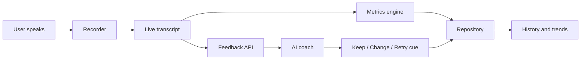

# Architecture Overview

**Purpose:** Show how VoiceLab is built and how data moves.
**Last updated:** 2026-10-21

## In one paragraph

VoiceLab is a Next.js web app, installable on a phone (a PWA). Recording and storage happen in the user's browser. Live transcription uses the browser's built-in speech recognition (see privacy boundaries below). The server only does two things: forward transcript text to the AI coach, and (as a fallback) transcribe audio. Nothing is stored on a server. The transcription approach is provisional until the feasibility spike (milestone 1, checkpoint C5).

## Components

| Component | Where it runs | Job |
|-----------|---------------|-----|
| UI screens | Browser | Home, session, feedback, history, settings |
| Recorder | Browser | Captures audio from the microphone |
| Transcriber | Browser (Web Speech API) | Live transcript while the user speaks |
| Metrics engine | Browser | Computes fillers per minute, words per minute |
| Analysis and profile (decision 90) | Browser | Measures every take in depth (`src/core/analysis/`), saves it in the `analyses` collection, and builds the speaking profile at `/profile` |
| Weekly summary API (decision 90) | Server (Next.js route) | Sends a compact table of the week's measures to the AI coach, returns a structured summary |
| Deeper analysis API (decision 91) | Server (Next.js route `/api/analyse`) | Opt-in: takes one saved take's audio, sends it to AssemblyAI and the voice worker at once, returns the transcript and voice numbers; stores nothing |
| Voice worker (decision 91) | Separate Python service (`voice-worker/`, on Modal or Cloud Run) | Praat and librosa voice measures for one recording, behind a shared secret; keeps nothing |
| Repository | Browser (IndexedDB) | Saves and loads sessions and settings, and the user's stories (decision 92) |
| Storytelling (decision 92) | Browser | `/stories` (today's story, your stories with "Tell it again", your moments to tell properly, the prompt bank) and `/stories/tell` (shape, focus, length), then the usual recording page with a planning minute. Story checks are pure functions in `src/core/storyChecks.ts`; the library in `src/core/storyLibrary.ts`; titles in the `stories` collection |
| Feedback API | Server (Next.js route) | Sends transcript text to the AI coach, returns keep/change/retry |
| Transcribe API | Server (Next.js route) | Fallback: audio to text when Web Speech is unavailable |
| Access gate and cost guard | Server | Passphrase check, rate limit, and daily call cap, with counters in a small shared store (server memory alone is not reliable on serverless hosting; see risks.md R4) |

## Data flow for one session



## Privacy boundaries

- Saved recordings stay on the device.
- Live transcription uses the browser's speech recognition. In most browsers this sends audio to the browser maker's servers (Google in Chrome, Apple in Safari, Microsoft in Edge), not ours. The user is told before the microphone is first used, in Settings and on the conversation pages (decision 97). Chrome 139 and later can recognise on the device if a page asks (`processLocally`, with a one-time language download); the app does not ask yet.
- If the Whisper fallback is used, audio goes to OpenAI through our server route. The user is told.
- Only transcript text is sent to the AI coach, with the measured numbers. The user's own notes after listening back are sent too only if they switch on "Let the coach read my notes" in Settings (off by default; decision 31).
- No accounts and no server database in v1.

## Planned code layout

```
src/
  app/            Screens and API routes
  config/         Model names and limits (one place to change them)
  server/         Server-only code: settings check, passphrase gate, rate limits, the coach
  core/           Pure logic: metrics, feedback parsing, focus rules (most tests live here)
  data/           Repository over IndexedDB
  audio/          Recorder and transcriber wrappers
  components/     Reusable UI pieces
  theme/          All colors and fonts, and the CSS built from them
tests/            Unit, integration, and a few end-to-end tests
documents/        This folder
```

Rule: logic goes in `core/` with no browser dependencies, so it can be tested quickly.

## Feedback route

`POST /api/feedback` with header `x-voicelab-passphrase` and body `{ transcript, durationSec, focusId, previousChange, mode?, promptId?, question?, story? }` (`story`: a told story's shape, focus and length as known ids only; decision 92). Checks run in this order, so nothing costs money until the last step: settings present (500 naming the missing variable), passphrase (401), body shape and size (400), shared rate limit (429 with `Retry-After`; 503 if the counter store is down), then the coach (200 `{ feedback }`, 422 if declined, 502 on failure). Logic: `src/server/feedbackHandler.ts`; prompt: `src/core/coachPrompt.ts`. A told story goes to the story coach (`STORY_SYSTEM_PROMPT`, `StoryFeedbackSchema`): keep, change and retry cue, the beats it heard with quotes, one line and how it could sound, the usual rubric, and the story scores, which the app keeps as `rub.story_*` measures.

`POST /api/questions` was removed with Q&A practice (decision 61).

## Speaking profile and weekly summary route (decision 90)

Every saved take is measured (`src/core/analysis/device.ts`, `language.ts`, `placement.ts`; record built by `analysis.ts`; saved by `src/data/analyses.ts` from `saveRecording` and `saveConversationSession`). The coach's reply carries an internal rubric beside the feedback (`RubricSchema` in `src/core/coachPrompt.ts`; the route answers `{ feedback, rubric }`), which `feedbackClient` saves into the take's analysis. `/profile` (`src/components/screens/ProfileScreen.tsx`, linked from Settings and History) measures older takes in batches, builds the profile (`src/core/analysis/profile.ts`) and, with `?session=ID`, shows one take's full table (linked from its results as "See all measures for this take").

`POST /api/summary` with the passphrase header and a compact table (`SummaryInputSchema` in `src/core/weeklySummary.ts`: per family's measures, patterns, short quotes, word swaps, favourite words, last week's focus; at most 12,000 characters of text). It runs the shared checks (`src/server/guard.ts`; 2 a minute and 3 a day, `SUMMARY_LIMITS`), then asks `WEEKLY_SUMMARY_MODEL` (`src/server/summary.ts`, structured output, no retries) and answers 200 `{ summary, model }`, 422 on a decline, 502 on a failure. Logic: `src/server/summaryHandler.ts`; the app's side: `src/data/summaryClient.ts`, called when the profile opens and a summary is due. Measures and rules: [measurements.md](measurements.md).

## Deeper analysis route and voice worker (decision 91)

Off unless "Send my recordings for deeper analysis" is on. Right after a take is saved, `requestDeepAnalysis` (`src/data/deepAnalysisClient.ts`, called from `RecordingScreen` without waiting) posts the audio to `POST /api/analyse` with the passphrase header and `x-voicelab-duration`. The route (`src/server/analyseHandler.ts`) checks, in order: passphrase (401), that AssemblyAI or the worker is set up (503 `not-set-up`), the audio's kind (415), length (400) and size (413, `ANALYSE_MAX_BYTES`), then the shared rate limit (`ANALYSE_LIMITS`, 429; 503 if the counter is down). It then runs the `Transcriber` (`src/server/transcriber.ts`, AssemblyAI) and the `VoiceWorker` (`src/server/voiceWorker.ts`, our `voice-worker/` service) at once, each with its own time limit, and answers 200 `{ transcript, voice, failures }` (either part may be null) or 502 when both failed. `GET /api/analyse` (passphrase only, free) says which parts are set up, for Settings. The app keeps the result in the take's analysis (`withServerAnalysis` in `src/core/analysis/analysis.ts`; measures from `src/core/analysis/server.ts`) and a quiet note on the take's page (`src/core/analysis/deep.ts`). Measures and engines: [measurements.md](measurements.md).

## Conversation route (decisions 83 and 84)

`POST /api/conversation` with the same header and body `{ personaId, scenarioId, twist, turns: [{ who, text }], stage, heard }`. It runs the same checks (`src/server/guard.ts`; 20 a minute, 150 a day), then asks Claude Haiku (`src/server/conversationWriter.ts`; prompt, message and `cleanLine` in `src/core/conversationTurn.ts`) to write the persona's next line, keeps only the allowed delivery directions, and has ElevenLabs speak it in the persona's voice (`createPersonaVoice` in `src/server/voice.ts`, `eleven_v4`, when `ELEVENLABS_API_KEY` is set). It answers 200 `{ text, audio, goodbye }` (audio as base64 MP3, or null when there is no key or the voice failed), 404 for an unknown persona or situation, 422 on a decline, and 502 on a failure; the app then ends the conversation, saving what was said. Without a passphrase the app never calls it and plays the persona's recorded script. Logic: `src/server/conversationHandler.ts`; the app's side: `src/data/conversationClient.ts` and `src/components/screens/ConversationScreen.tsx`. After the conversation, the feedback route takes an optional `conversation` (the same turns) and sends it to its own coach prompt (`CONVERSATION_SYSTEM_PROMPT`).

## Recording (desktop first)

`/session?prompt=...&mode=...&retryOf=...` shows the prompt, then records. `src/audio/browserServices.ts` holds the browser pieces behind small contracts in `src/audio/services.ts`: live transcription (restarts when the browser stops listening by itself, keeping earlier words), MediaRecorder for the audio, and a Web Audio level meter. Space starts and stops; Esc discards. Warm-ups stop at 30 seconds, full sessions at 3 minutes. Stopping saves the session (`src/data/saveRecording.ts`: numbers, the week's focus, the baseline rule, audio), opens `/sessions?id=...`, and that page asks the coach for feedback straight away. The session page plays the saved audio back (the baseline is labelled as the first recording) and leads with the number for that week's focus (`src/core/focusMeasure.ts`). Recordings under 10 seconds are not saved. Two modes: Rapid Fire (`mode=talk`, called Table Topic until decision 85) briefs the user, reveals a light question from `TABLE_TOPICS`, and counts down 10 seconds before recording with Toastmasters lights; a Record Response (`mode=response`) gives 2 minutes to think with `STRUCTURE_HINT` and the prompt's `angles`, then a 3:00 goal light. Timings live in `src/core/recordingRules.ts` (`thinkSeconds`, `timeSignal`, `timingSentence`). Reading aloud (`mode=read`) shows a passage from `PASSAGES`; `src/core/readAlong.ts` lines the transcript up with the text word by word (longest common sequence) to mark words not heard. `src/core/compare.ts` finds the earlier take for "then and now". `src/core/pauses.ts` finds pauses in the loudness readings saved with each session (adaptive silence threshold, pauses of 0.6 seconds or more). The skill path (`/lessons`, `mode=lesson`) uses `src/content/lessons.ts`, and `src/core/lessonCheck.ts` turns each lesson's check into a sentence (with `leadingSilenceSeconds` and `fadingEnds` from `src/core/pauses.ts`). The practice library (`/library`) lists `PASSAGES`, `PAUSE_DRILLS` and `TRICKY_WORDS`. The pause drill (`mode=pause`) uses `PAUSE_DRILLS`; Rehearse my talk (`/rehearse`, `mode=rehearse`) uses the user's saved talks from the "talks" collection, and its coach request carries no script. Pages are grouped by job (decision 25): Today (`/`, `src/components/screens/HomeScreen.tsx`, with `nextStep` from `src/core/nextStep.ts` and the welcome flag in `src/data/welcome.ts`), Talks (`/rehearse`, `/talk`), Practice (`/practice`, `/bookends`, `/qa`), and Skills (`/skills`; `/lessons` and `/library` redirect there). Mode names and descriptions come from `src/content/modes.ts`, which also feeds the "How this works" note on the recording screen. Q&A practice (`/qa?from=...`, `mode=qa`) asks `POST /api/questions` (`src/server/questionsHandler.ts`, `src/server/questioner.ts`, prompt in `src/core/questionsPrompt.ts`) for three likely audience questions from a session's transcript, or saves the user's own (`src/data/questionsClient.ts`); the questions are stored on that session. Both paid routes run the same checks in `src/server/guard.ts` (settings, passphrase, body, shared rate limit) before calling the model. Openings and closings (`/bookends`, `mode=bookend`) use `BOOKENDS` in `src/content/prompts.ts` and `src/core/bookend.ts`. The list of session kinds lives once, in `SESSION_MODES` (`src/data/records.ts`), and the address reader, the import check and the server all use it. Each talk has its own page (`/talk?id=...`, `src/components/screens/TalkScreen.tsx`) with its date and a countdown plan from `src/core/eventPrep.ts` (`talkSections`, `memoryLadder`, `eventPlan`, `stepTasks`, `taskProgress`, `runTimes`); a rehearsal can cover one section (`&section=1`) and start on a rung of the memory ladder (`&ladder=keywords`). For readings, the coach request carries the passage id and the server looks up the text itself, so no free text beyond the transcript reaches the model. A failed save shows the browser's reason instead of hanging. A blocked or missing microphone, a browser without speech recognition, a dropped speech service, or nothing heard are explained and nothing is saved.

## Getting feedback to the device

A saved session starts with feedback `pending`. `src/data/feedbackClient.ts` sends it to the feedback route with the passphrase (kept in this browser's local storage, never in exports) and saves the reply. A background sender (`src/components/FeedbackSync.tsx`) sends waiting sessions oldest first when the app opens and when the device comes back online, stopping at the first problem that would block the rest (no passphrase, server not set up, offline or rate limited). A decline or invalid data marks the session `failed` so it is not sent again. Settings shows how many sessions are waiting and can send them on request.

## Installing and working offline

The app is installable (`src/app/manifest.ts`, icons in `public/icons/`, iPhone settings in the layout). In the released app a hand-written service worker (source in `src/serviceWorker/sw.template.js`, registered by `src/components/ServiceWorkerRegister.tsx`) saves every main page, each page's data for moving between tabs, every built script and the fonts the pages use when it installs (decisions 88 and 99). `pnpm build` writes it to `public/sw.js` after `next build` (`scripts/build-sw.mjs`), with Next.js's build id in its page cache's name and the build's file list, so each release installs a new worker. Built files live in `voicelab-static`, shared across releases (their names carry content hashes, so an unchanged file is not downloaded again); a new worker deletes the previous release's page cache, but keeps the built files the previous release uses until the release after, so a tab still open on it can load a script it needs later (decision 99). It never touches the voice recordings' cache (`voicelab-voice-v1`). A saved page or page data is answered at once from the saved copy and refreshed in the background; a refresh that comes from a newer release is not saved into this release's cache (its scripts are not this build's), and the worker asks the browser to fetch the newer worker instead. With nothing saved, the network is waited for (a slow one up to 3 seconds before any saved copy); each page is saved once, under its path. Built files and icons come from the cache first; the feedback API is never cached. One page, `/sessions?id=...`, shows any saved session, so every past session opens offline. A page not saved shows a short offline note. Saved data lives in IndexedDB, so it is all there without a connection.

To keep the first download small, pages that only need the full speeches' names use `src/content/speechIndex.ts` (written from `speeches.ts` by `pnpm speech-index`) and `readingIndex.ts`; the speeches' text loads only on the reading pages (`useReading`). Today, a saved session, a Learn card and the voice pages load the daily plan's code beside their data (`src/data/loadDailyPlanLater.ts`).

## Failure behavior

| Failure | What the user sees |
|---------|--------------------|
| Microphone blocked | Plain explanation and how to enable it |
| Web Speech unavailable | Automatic switch to the Whisper fallback |
| Offline | Session is saved; feedback is requested when back online |
| AI call fails or cap reached | Transcript and numbers still shown; coach feedback retried later |
