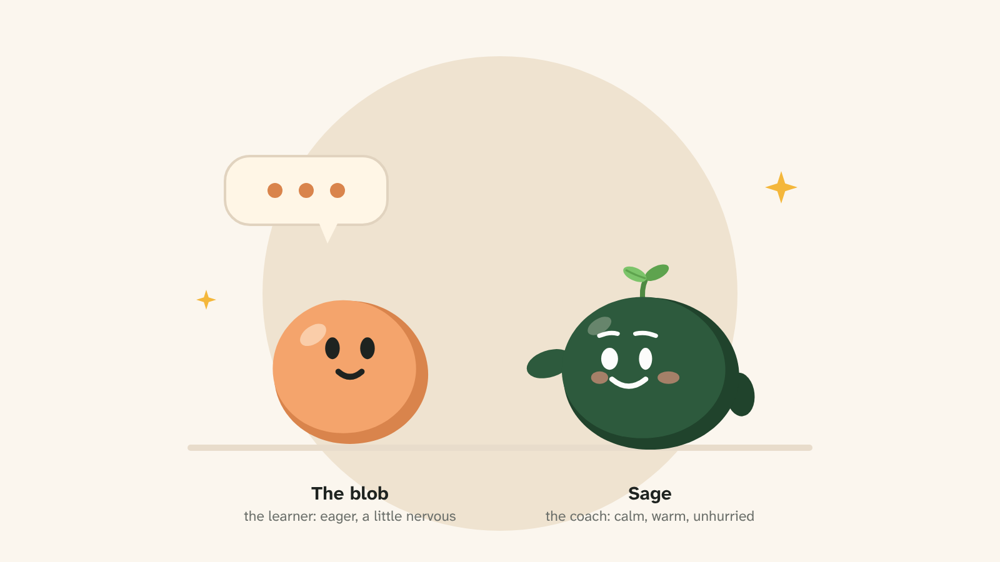
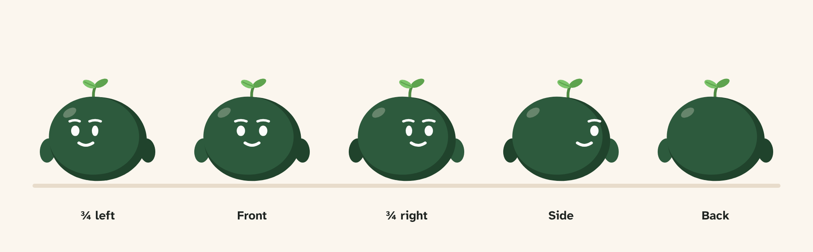
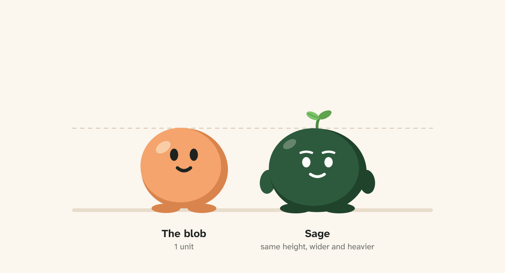
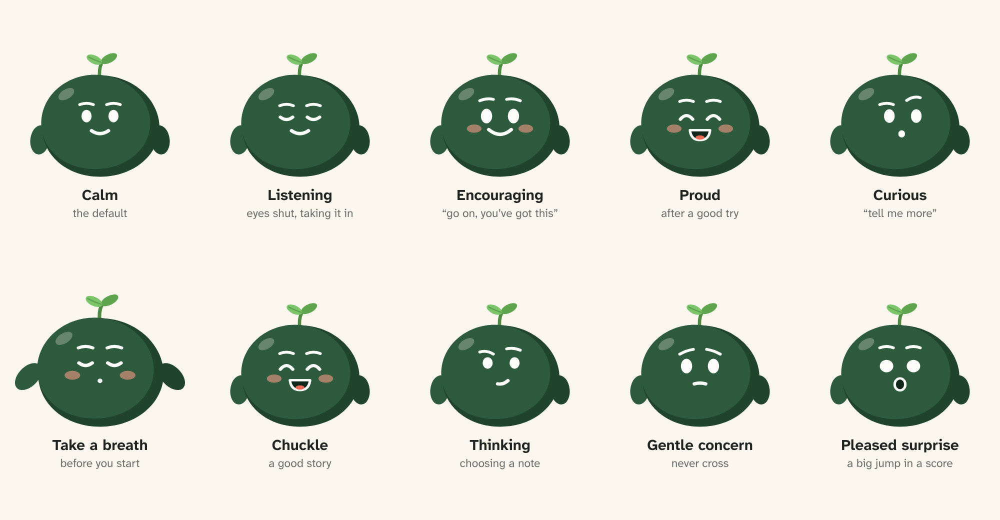
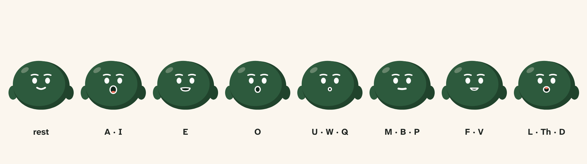
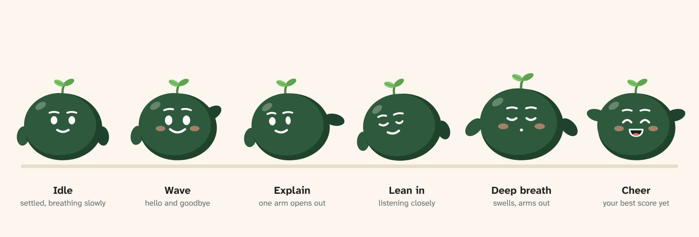
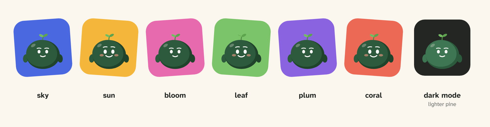
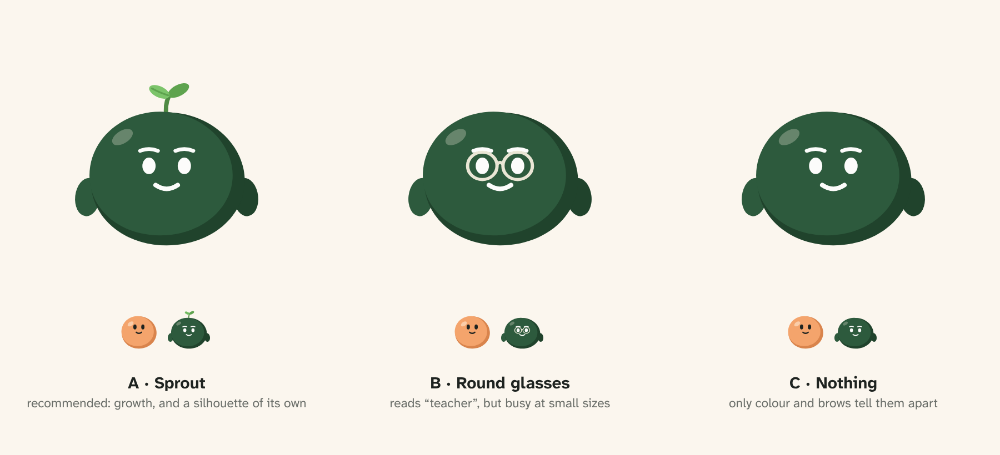

# Character sheet: Sage, the green blob

**Status:** draft for approval (2026-10-30). Nothing in the app uses Sage yet. Once the sheet is approved, the rig comes next, and the colours become theme roles.
**Code:** `video/src/characters/Sage.tsx` (the drawing), `video/src/characters/SageSheet.tsx` (the panels below). Re-render a panel with `npx remotion still src/index.ts sage-<panel> out/sage/<panel>.png --browser-executable /opt/pw-browsers/chromium` from `video/`.
**Read with:** [art-style.md](../art-style.md). Sage follows every rule there for the blob, except where this sheet says otherwise.

## 1. Who Sage is

**The coach.** The warm blob is the learner: eager, earnest, a little nervous. Sage is the one beside it who has been there before. Calm, warm, unhurried, with a quiet, dry sense of humour.

| | The blob | Sage |
|---|---|---|
| Role | The learner (stands in for you) | The coach (explains, listens, encourages) |
| Energy | Bouncy, quick, hops when pleased | Settled, slow, swells and nods |
| Face | Dark eyes, no brows, a simple smile | Pale eyes, soft brows, a small smile |
| When something goes wrong | Puzzled: "hmm" | Gently curious: "what happened there?" |
| Celebrates | Out loud, with a jump | Quietly, with a proud smile and a nod |
| Talks | Bright and quick (Mira) | Low, slow, with real pauses |

**What Sage believes:** one thing at a time. A pause is a tool, not a mistake. Every try counts. Sage never judges, never sighs, never looks disappointed, and never says "wrong". It is the app's promise (VoiceLab never makes you feel judged) with a face.

**Its relationship to the blob:** an older sibling or a favourite teacher. They like each other. In a lesson clip, Sage explains the idea and the blob gives its own example ("Here's mine…"). Sage reacts to it warmly, and sometimes gives one note.

## 2. How Sage looks

- **The same outline.** Drawn from `BLOB`, as the art style requires, so the two read as one family.
- **Bigger, but settled:** 10% bigger than the blob, squashed to 95% height and 102% width from its base. The two stand the same height, and Sage looks wider and heavier, like someone sitting comfortably.
- **Colour:** pine green with a darker crescent of shade at the lower right, lit from the upper left like the blob. In dark mode a lighter pine, so it doesn't sink into the background.
- **Face:** near-white eyes and mouth, as the green blob in Scenes has today. Sage is the only character with **permanent brows**: short, soft strokes that carry most of its expression. Its face sits a little lower than the blob's, and its highlight is a little smaller and higher, so the brows stay clear.
- **Signature (recommended): a sprout.** A curved stem and two leaves on its crown, the far leaf darker. It stands for growth, it gives Sage a silhouette of its own (it still reads at 64 px and in the gray theme), and it's a free extra movement: it sways a beat behind the body. Two other options are on the signature panel below.
- **Arms:** the same short ovals as the blob's, tucked behind the body, the far arm in the shade colour. The shoulders sit high enough that a raised arm (a wave, a cheer) shows above the body. No hands, no legs. Flat feet only when standing on something.

### Colours

| Part | Light | Dark mode | Becomes (proposed role) |
|---|---|---|---|
| Body | `#2d5a3d` | `#3e7552` | `sage` |
| Shade | `#20432c` | `#2c5a3d` | `sage-shade` |
| Face (eyes, mouth, brows) | `#fcfcfb` | `#fcfcfb` | `sage-ink` |
| Inside the mouth | `#10261a` | `#10261a` | `sage-shade` at full depth, or `on-warm` |
| Sprout leaves | art-leaf, far leaf darker | art-leaf | `art-leaf` (exists) |
| Cheeks | `#f59a86` at 60% | the same | `art-coral`, lightened |
| Highlight | art-cream at 28% | the same | `art-cream` (exists) |

The plain colours are only for this draft. The art style allows no raw colours in the app, so when Sage is approved these become roles in every theme. Gray stays gray; other themes keep Sage green, because a mascot that changes colour with the theme stops being recognisable.

## 3. Expressions

Ten faces. The blob's faces are built from eyes and a mouth; Sage's lean on the brows.

| Face | When |
|---|---|
| Calm | The default: explaining, waiting |
| Listening | While you speak: eyes softly shut, taking it in |
| Encouraging | Before you start; after a hard part |
| Proud | After a good try, or a goal reached |
| Curious | "Tell me more"; one brow up |
| Take a breath | Before a timed task: swells with the breath |
| Chuckle | A funny story, or the blob's own mistake |
| Thinking | Choosing which one note to give |
| Gentle concern | You stopped early, or a score fell. Never cross |
| Pleased surprise | A big jump in a score |

## 4. Mouth shapes for speech

Eight shapes, each standing for a group of sounds. The rig will turn the voice's word timings into these, so Sage's lips match its words rather than just its loudness.

## 5. Body language and movement

- **Slow.** A breath every 5 seconds (a small swell). Blinks every 5 to 7 seconds, at uneven times.
- **Settles.** After any move, Sage comes to rest with a small overshoot and stays still. It never bounces or hops: that's the blob's.
- **Listens with its whole body.** Leans in (about 8°), eyes shut, a slow nod on the other person's pauses.
- **Explains with one arm.** One arm opens out toward the idea (or the blob), then comes back.
- **The sprout follows.** It sways a beat behind every move, then settles. It's the one thing on Sage that's allowed to keep moving.
- **Within the art style's motion limits** in the app (slow, small, one main movement). Videos may go bigger.

## 6. Where Sage would appear

- **Lesson clips:** Sage teaches the idea, the blob gives its example, Sage reacts. Two voices make the clips feel like a conversation, not a lecture.
- **Results:** a small Sage beside the one goal for next time, with the face that fits (proud, curious, gentle concern).
- **Before a timed task:** "Take a breath" with the breathing pose.
- **Course shorts and the end card:** the blob and Sage together.

## 7. Drawing rules

- Always with its sprout, except in mouth close-ups for the rig.
- Never on a leaf-green ground: the sprout disappears (see the grounds panel). Sky, sun, bloom, plum and coral all work.
- Kind faces only: never cross, mocking, bored or sad.
- One accessory at most beyond the sprout, and only when it tells the idea.
- Sage is never smaller than the blob in the same picture.

## 8. How Sage talks

- **Pace:** slower than the narrator, with real pauses. Sage models what it teaches.
- **Words:** short sentences, one idea each, the app's plain voice. Questions more than instructions.
- **Sounds like:** "Take a breath. Then start with the point." · "That pause? Keep it." · "One thing for next time." · "What happened there?"
- **Never:** "wrong", "bad", "you should have", or hype ("Amazing!!!").
- **Voice (not recorded yet), from your ElevenLabs library:** Angus, "Calm & Measured" (recommended: low to mid pitch, Scottish, even pacing); Tasha, "professional, calm, friendly" (soft American); Astro, "calm & steady for learning" (American). Sage is drawn without a gender, so either works.

## 9. Open questions for approval

1. **Name:** "Sage" (wise, and green). Others: Moss, Fern, Basil, Juniper.
2. **Signature:** A sprout (recommended), B round glasses, or C nothing.
3. **The green blob in Scenes and Active listening:** today "the other person" is drawn as an accent-coloured blob, which in the default theme is the same green as Sage. Either keep it (the sprout tells them apart), or give the other person a new colour so Sage stays unique. Recommended: a new colour for the other person, so Sage only ever means Sage.
4. **Its own colour roles** (`sage`, `sage-shade`, `sage-ink`), green in every theme, rather than following the theme's accent.
5. **Voice:** one of the three above, or another.

